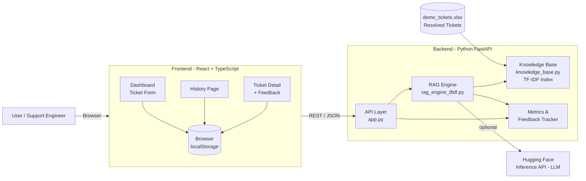
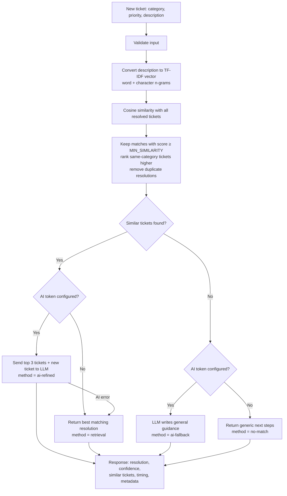

# TicketGenie – AI-Powered IT Support Ticket Resolution Platform

> **MCA Final Year Project**
> A web application that suggests resolutions for new IT support tickets by retrieving similar past tickets and (optionally) generating step-by-step guidance with a Large Language Model, using the **Retrieval-Augmented Generation (RAG)** approach.

---

## Table of Contents

1. [Abstract](#1-abstract)
2. [Problem Statement](#2-problem-statement)
3. [Objectives](#3-objectives)
4. [Scope and Limitations](#4-scope-and-limitations)
5. [Existing System vs Proposed System](#5-existing-system-vs-proposed-system)
6. [System Architecture](#6-system-architecture)
7. [Modules Description](#7-modules-description)
8. [Tools and Technologies Used](#8-tools-and-technologies-used)
9. [Dataset Description](#9-dataset-description)
10. [Project Structure](#10-project-structure)
11. [Navigation / User Guide](#11-navigation--user-guide)
12. [API Endpoints](#12-api-endpoints)
13. [Installation and How to Run](#13-installation-and-how-to-run)
14. [Testing](#14-testing)
15. [Results](#15-results)
16. [Future Enhancements](#16-future-enhancements)
17. [Conclusion](#17-conclusion)
18. [References](#18-references)

---

## 1. Abstract

IT help desks receive a large number of support tickets, and many of them describe problems that have already been solved before. TicketGenie is a web application that helps support engineers resolve such tickets faster. When a new ticket is submitted, the system searches a knowledge base of previously **resolved** tickets using **TF-IDF vectorisation** and **cosine similarity**, shows the most similar tickets with their resolutions, and, when an AI model is configured, uses a **Hugging Face Large Language Model** to write a clear, step-by-step resolution based on those past solutions. If no AI model is available, the system still works and returns the best matching past resolution. The application consists of a **React + TypeScript** frontend and a **Python FastAPI** backend, and can be deployed as a single service.

---

## 2. Problem Statement

In most organisations, IT support tickets are handled manually by help-desk engineers. This leads to the following problems:

- **Repeated effort** – the same issues (VPN failures, password lockouts, printer problems, etc.) are reported again and again, and engineers solve them from scratch each time.
- **Knowledge is not reused** – solutions to past tickets are stored in ticketing tools but are hard to search, so this knowledge is rarely used for new tickets.
- **Slow resolution and inconsistent quality** – resolution time and quality depend on the experience of the individual engineer handling the ticket.
- **Dependence on senior staff** – junior engineers frequently need to escalate simple issues because they cannot find earlier solutions.

**Problem:** *To design and develop a system that automatically finds similar previously-resolved tickets for a new IT support ticket and suggests a suitable, explainable resolution, so that tickets can be resolved faster and more consistently.*

---

## 3. Objectives

1. To build a knowledge base of resolved IT support tickets from historical data (Excel/CSV).
2. To retrieve the most similar past tickets for a new ticket using TF-IDF and cosine similarity.
3. To generate a clear, step-by-step resolution using a Large Language Model, grounded in the retrieved tickets (RAG).
4. To keep the system usable without AI by falling back to the best retrieved resolution.
5. To make suggestions **explainable** by showing the matching tickets and their similarity scores.
6. To provide a simple web interface for submitting tickets, viewing history and giving feedback.
7. To track performance metrics (response time, similarity, feedback) through a REST API.

---

## 4. Scope and Limitations

### Scope
- Suggesting resolutions for IT support tickets in eight categories: Application Bug, Email Issues, Hardware Request, Network Connectivity, Password Reset, Printer Issues, System Crash and VPN Access.
- Works with any Excel/CSV ticket dataset that has *Category*, *Description* and *Resolution* columns.
- Runs fully offline in **retrieval mode**. AI generation is optional.

### Limitations
- **Synthetic demo data:** the bundled dataset (`demo_tickets.xlsx`, 216 tickets) is synthetic and was created for demonstration. Results on real help-desk data will differ.
- **Lexical similarity:** TF-IDF matches words and word fragments, not meaning. Synonyms that share no words (e.g. *"can't get online"* vs *"no internet access"*) may not match.
- **Ticket history is stored in the browser** (localStorage). There is no user login or central ticket database.
- **Metrics and feedback are kept in memory** and reset when the backend restarts.
- **AI generation needs a Hugging Face API token** and an available model. Free-tier models can be slow or rate-limited.
- **The original `Sample-Data.xlsx` is not used by default.** It has 10,000 rows but only 18 distinct ticket descriptions, each paired at random with 3 resolutions (some unrelated, e.g. a battery issue "resolved" by replacing a monitor), and about half of its tickets are still Open/In Progress. It is kept only for reference; see [Dataset Description](#9-dataset-description).

---

## 5. Existing System vs Proposed System

| Aspect | Existing (manual) system | Proposed system (TicketGenie) |
|---|---|---|
| Finding past solutions | Manual keyword search in ticket tool | Automatic similarity search over resolved tickets |
| Resolution writing | Written by engineer each time | Suggested automatically (retrieval or AI-generated) |
| Consistency | Depends on engineer's experience | Based on proven past resolutions |
| Explainability | – | Shows matching tickets with similarity % |
| Works without internet/AI | – | Yes (retrieval mode) |
| Feedback loop | Rarely captured | 👍 / 👎 feedback per suggestion |
| Metrics | Manual reports | Live response-time, similarity and feedback metrics |

---

## 6. System Architecture

### 6.1 Architecture Diagram



### 6.2 RAG Workflow (how a resolution is produced)



**Confidence** shown in the UI is the plain cosine similarity (0–100 %) between the new description and the best matching resolved ticket. It is not boosted.

---

## 7. Modules Description

| # | Module | File(s) | Description |
|---|---|---|---|
| 1 | **Dataset & Knowledge Base** | `backend/knowledge_base.py` | Reads the Excel/CSV dataset, detects columns, keeps only Resolved/Closed tickets, removes duplicates and builds the TF-IDF index (word 1–2-grams + character 3–5-grams). |
| 2 | **Retrieval (Similarity Search)** | `backend/rag_engine_tfidf.py` → `find_similar_tickets()` | Computes cosine similarity, filters by threshold, ranks same-category tickets higher and returns up to *k* tickets with distinct resolutions. |
| 3 | **Generation (AI)** | `backend/rag_engine_tfidf.py` → `suggest_resolution()` | Builds a prompt from the top tickets and calls the Hugging Face LLM. Falls back to the retrieved resolution if AI is not configured or fails. |
| 4 | **REST API** | `backend/app.py` | FastAPI endpoints for suggestions, categories, feedback, stats, metrics and health. Validates input and serves the built frontend. |
| 5 | **Metrics & Feedback** | `backend/metrics.py` | Thread-safe tracking of response times, similarity scores, success rate and user feedback. |
| 6 | **Ticket Submission UI** | `frontend/src/components/TicketUpload/TicketUploadForm.tsx` | Form with category, priority and description. Shows the suggestion and similar tickets. |
| 7 | **Resolution Display** | `frontend/src/components/ResolutionSuggestion/ResolutionResult.tsx` | Shows how the resolution was produced, the match %, and the matching tickets. |
| 8 | **History & Feedback UI** | `frontend/src/pages/HistoryPage.tsx`, `TicketDetailPage.tsx`, `api/ticketApi.ts` | Stores submitted tickets in the browser, lists them, shows details and collects 👍/👎 feedback. |
| 9 | **Dataset Generator** | `backend/scripts/generate_demo_dataset.py` | Generates the synthetic demo dataset (72 issue types × 3 phrasings = 216 tickets). |

---

## 8. Tools and Technologies Used

| Layer | Technology | Purpose |
|---|---|---|
| Frontend | **React 19**, **TypeScript 5** | User interface |
| Frontend | **Vite 5** | Development server and production build |
| Frontend | **React Router 7** | Page navigation |
| Frontend | **Axios** | HTTP requests to the backend |
| Frontend | **SCSS / CSS** | Styling |
| Backend | **Python 3.11** | Backend language |
| Backend | **FastAPI**, **Uvicorn** | REST API framework and ASGI server |
| Backend | **Pydantic** | Request/response validation |
| ML / NLP | **scikit-learn** (TfidfVectorizer, cosine_similarity) | Text vectorisation and similarity search |
| Data | **pandas**, **openpyxl** | Reading the Excel dataset |
| AI | **Hugging Face Inference API** (`huggingface_hub`), default model `Qwen/Qwen2.5-7B-Instruct` | LLM-based resolution generation (optional) |
| Testing | **pytest** (backend), **Vitest** + **React Testing Library** (frontend) | Automated tests |
| Deployment | **Railway** with **Nixpacks** | Cloud hosting (single service) |
| Tools | Git & GitHub, VS Code | Version control and development |

---

## 9. Dataset Description

### 9.1 Demo dataset (used by default) – `backend/data/demo_tickets.xlsx`

| Property | Value |
|---|---|
| Total tickets | 216 (all Resolved/Closed) |
| Categories | 8 (27 tickets each) |
| Distinct issue types | 72 (each with its own correct resolution) |
| Phrasings per issue | 3 (different ways users describe the same problem) |
| Columns | Ticket ID, Category, Description, Resolution, Priority, Status, Created Date, Resolved Date |

Example rows:

| Ticket ID | Category | Description | Resolution |
|---|---|---|---|
| TKT0085 | VPN Access | VPN keeps disconnecting every few minutes. | Switched VPN protocol to TCP, disabled Wi-Fi power saving, updated the network adapter driver… |
| TKT0196 | Printer Issues | Printer paper jam error even with no paper stuck. | Opened all trays and the rear door, removed a small torn piece of paper, cleaned the rollers… |

To regenerate it: `python scripts/generate_demo_dataset.py` (from `backend/`).

### 9.2 Using your own dataset
Any `.xlsx` or `.csv` file with at least **Category**, **Description** and **Resolution** columns works (optional: Ticket ID, Priority, Status). Set `DATASET_PATH=data/your_file.xlsx` in `backend/.env`. Rows whose Status is not *Resolved* or *Closed* are skipped.

### 9.3 Original `Sample-Data.xlsx` (kept for reference only)
10,000 rows, but only **18 unique descriptions**, each paired at random with 3 resolutions, and about 50 % of the tickets are not resolved. After cleaning, only 54 usable tickets remain, and some of their resolutions do not match the problem. For this reason it was replaced by the demo dataset.

---

## 10. Project Structure

```
ai-ticket-resolution-platform/
├── backend/                         # Python FastAPI RAG service
│   ├── app.py                       # REST API + serves built frontend
│   ├── rag_engine_tfidf.py          # RAG engine: retrieval + AI generation
│   ├── knowledge_base.py            # Dataset loading + TF-IDF index
│   ├── metrics.py                   # Metrics & feedback tracking
│   ├── setup_config.py              # Creates backend/.env
│   ├── .env.example                 # Configuration template
│   ├── requirements.txt             # Runtime dependencies
│   ├── requirements-dev.txt         # + pytest, httpx
│   ├── requirements-railway.txt     # Deployment dependencies
│   ├── data/
│   │   ├── demo_tickets.xlsx        # Demo knowledge base (default)
│   │   └── Sample-Data.xlsx         # Original data (reference only)
│   ├── scripts/
│   │   ├── generate_demo_dataset.py # Creates demo_tickets.xlsx
│   │   └── build_knowledge_base_tfidf.py  # Validates dataset + sample searches
│   └── tests/                       # pytest test suite
├── frontend/                        # React + TypeScript (Vite)
│   ├── index.html
│   ├── package.json
│   ├── .env.example
│   └── src/
│       ├── main.tsx                 # Entry point
│       ├── App.tsx                  # Layout, navigation, routes
│       ├── pages/                   # Dashboard, History, TicketDetail
│       ├── components/              # Ticket form, resolution view, common UI
│       ├── api/                     # Backend calls + local ticket storage
│       ├── hooks/                   # React hooks (upload, resolution, feedback)
│       ├── config/apiConfig.ts      # Backend URL and endpoints
│       └── types/                   # TypeScript types
├── nixpacks.toml, railway.json      # Railway deployment config
├── start.sh                         # Production start script
└── README.md
```

---

## 11. Navigation / User Guide

| Page | URL | What you can do |
|---|---|---|
| **Dashboard** | `/` | See live stats (tickets in knowledge base, average response time, resolution mode) and submit a new ticket. |
| **History** | `/history` | See all tickets submitted from this browser with match % and feedback. Click a Ticket ID to open it. |
| **Ticket Detail** | `/ticket/<id>` | View the full ticket, the suggested resolution, the similar tickets, and give 👍/👎 and written feedback. |
| **API Docs** | `/docs` (backend) | Interactive Swagger UI for all REST endpoints. |

**Step-by-step demo:**

1. Open the **Dashboard**.
2. Select a **Category** (e.g. *VPN Access*) and **Priority** (e.g. *High*).
3. Enter a **Description**, e.g. *"VPN disconnects every few minutes when I work from home"*.
4. Click **Submit Ticket**. The system shows:
   - the **Ticket Summary** with a Ticket ID link,
   - the **Recommended / AI-Generated Resolution** with its match %,
   - the **Similar Resolved Tickets** used to produce it.
5. Open **History** in the top menu to see the ticket. Click its ID to open **Ticket Detail**.
6. Click **👍 Yes** or **👎 No** and optionally write a comment. Feedback is sent to the backend (`/api/metrics` → `feedback`).

Try also: *"paper stuck in printer"*, *"Outlook on my phone is not syncing"*, *"blue screen keeps appearing"*, and an unrelated text like *"hello how are you"* to see the **No Similar Tickets Found** case.

---

## 12. API Endpoints

Base URL (local): `http://localhost:8000`

| Method | Endpoint | Description |
|---|---|---|
| `POST` | `/api/suggest-resolution` | Body `{category, priority, description}` → suggested resolution, confidence, similar tickets, timing |
| `GET` | `/api/categories` | Categories present in the knowledge base |
| `POST` | `/api/feedback/{ticket_id}` | Body `{feedback, helpful}` → records feedback |
| `GET` | `/api/stats` | Knowledge-base size, top categories, AI availability |
| `GET` | `/api/metrics` | Response times, confidence, success rate, feedback summary |
| `GET` | `/api/metrics/realtime` | Metrics for the last 100 queries |
| `GET` | `/health` | Health check |
| `POST` | `/api/reload-knowledge-base` | Reloads the dataset (requires `X-Admin-Token` header = `ADMIN_TOKEN`) |

Example request:

```bash
curl -X POST http://localhost:8000/api/suggest-resolution \
  -H "Content-Type: application/json" \
  -d '{"category":"Printer Issues","priority":"Medium","description":"Printer shows offline"}'
```

Example response (shortened):

```json
{
  "suggested_resolution": "Recommended resolution (from ticket TKT0190, 82% match):\nRestarted the print spooler, removed and re-added the printer using its IP address and printed a test page.\n...",
  "confidence": 0.8161,
  "similar_tickets": [{ "ticket_id": "TKT0190", "category": "Printer Issues", "description": "Printer shows offline on my computer.", "similarity_score": 0.8161, "...": "..." }],
  "method": "retrieval",
  "timing": { "search_time_ms": 2.94, "generation_time_ms": 0.04, "total_time_ms": 2.98 },
  "metadata": { "model": "template", "num_similar_tickets": 2, "ai_generated": false }
}
```

---

## 13. Installation and How to Run

### 13.1 Prerequisites

| Software | Version | Check with |
|---|---|---|
| Python | 3.10 or later (3.11 recommended) | `python --version` |
| Node.js | 20 or later | `node --version` |
| npm | comes with Node.js | `npm --version` |
| Git | any | `git --version` |

### 13.2 Clone the repository

```bash
git clone https://github.com/jagadishjk1/ai-ticket-resolution-platform.git
cd ai-ticket-resolution-platform
```

### 13.3 Run the backend (Terminal 1)

```bash
cd backend

# 1. Create and activate a virtual environment
python -m venv venv
venv\Scripts\activate            # Windows
# source venv/bin/activate       # macOS / Linux

# 2. Install dependencies
pip install -r requirements.txt

# 3. Create the configuration file
copy .env.example .env           # Windows
# cp .env.example .env           # macOS / Linux

# 4. (Optional) check the knowledge base and see sample searches
python scripts/build_knowledge_base_tfidf.py

# 5. Start the API server
uvicorn app:app --port 8000
```

> **Tip:** `uvicorn app:app --reload` restarts the server automatically when code changes, but it also watches the `venv` folder. In a OneDrive/Dropbox folder this causes constant restarts ("Failed to fetch" in the browser). Use it only with the venv excluded: `uvicorn app:app --reload --reload-exclude venv`, or simply restart the server manually after code changes.

> **Windows PowerShell:** if activating the venv or running `npm` fails with *"running scripts is disabled on this system"*, run `Set-ExecutionPolicy -Scope CurrentUser RemoteSigned` once (or use `npm.cmd` instead of `npm`).

The backend is ready when you see `Knowledge base ready: 216 tickets`. Open <http://localhost:8000/docs> to see the API.

**Optional – enable AI generation:** create a free token at <https://huggingface.co/settings/tokens>, put it in `backend/.env` as `HUGGINGFACE_API_TOKEN=hf_...` and restart the backend. You can change the model with `HF_MODEL`. Without a token, the app runs in retrieval mode.

### 13.4 Run the frontend (Terminal 2)

```bash
cd frontend
npm install
npm run dev
```

Open <http://localhost:5173>. The frontend calls the backend at `http://localhost:8000` (change with `VITE_API_URL` in `frontend/.env`).

### 13.5 Run as a single app (production mode)

```bash
cd frontend && npm run build && cd ..
cd backend && uvicorn app:app --port 8000
```

Open <http://localhost:8000>. FastAPI serves the built React app and the API together.

### 13.6 Deploy to Railway
Push to GitHub, create a Railway project from the repository and deploy. `nixpacks.toml` installs Python and Node, builds the frontend and starts the backend with `start.sh`. Set `HUGGINGFACE_API_TOKEN` (optional) and `CORS_ORIGINS` in Railway → Variables.

### 13.7 Configuration (`backend/.env`)

| Variable | Default | Meaning |
|---|---|---|
| `HUGGINGFACE_API_TOKEN` | *(empty)* | Enables AI generation |
| `HF_MODEL` | `Qwen/Qwen2.5-7B-Instruct` | Hugging Face chat model |
| `AI_TIMEOUT_SECONDS` | `20` | Timeout for AI calls |
| `TOP_K_SIMILAR` | `5` | Maximum similar tickets returned |
| `MIN_SIMILARITY` | `0.2` | Minimum cosine similarity for a match |
| `DATASET_PATH` | `data/demo_tickets.xlsx` | Dataset to load |
| `CORS_ORIGINS` | `*` | Allowed frontend origins (comma-separated) |
| `ADMIN_TOKEN` | *(empty)* | Enables the reload endpoint |
| `PORT` | `8000` | Server port |

---

## 14. Testing

### 14.1 Backend (pytest)

```bash
cd backend
pip install -r requirements-dev.txt
python -m pytest -v
```

| Test file | What it checks |
|---|---|
| `tests/test_knowledge_base.py` | Dataset loading, skipping unresolved/duplicate rows, column detection |
| `tests/test_rag_engine.py` | Relevant top match for realistic queries, "no match" for unrelated text, distinct resolutions, honest confidence, AI success and AI-failure fallback (AI is mocked) |
| `tests/test_metrics.py` | Success rate, feedback summary, real-time stats |
| `tests/test_api.py` | Endpoints, input validation (422), feedback, admin-protected reload |

### 14.2 Frontend (Vitest)

```bash
cd frontend
npm run test:run        # run all tests once
npm run test:coverage   # with coverage report
npm run build           # type-check + production build
```

### 14.3 Sample test cases

| # | Input (category / description) | Expected result |
|---|---|---|
| 1 | VPN Access / "VPN disconnects every few minutes when I work from home" | Top match: *VPN keeps disconnecting every few minutes* |
| 2 | Printer Issues / "paper stuck in printer" | Top match: *Printer paper jam error…* |
| 3 | Email Issues / "Outlook on my phone is not syncing new mail" | Top match: *Outlook emails not syncing on my phone* |
| 4 | Any / "hello how are you" | "No Similar Tickets Found" with generic next steps |
| 5 | Description of 1–4 characters | Form blocks submission; API returns 422 |
| 6 | Backend stopped | Dashboard shows "Backend not reachable"; form shows a clear error |

---

## 15. Results

- For realistic descriptions in the eight categories, the correct issue type is returned as the **top match** (see test cases above and `tests/test_rag_engine.py`).
- Unrelated text is correctly identified as **no match** instead of returning a wrong resolution.
- Retrieval is fast: the search over the 216-ticket knowledge base takes a few milliseconds. With AI enabled, total time depends on the Hugging Face model (typically a few seconds).
- Each suggestion is explainable: users see the matched tickets and their similarity percentages.

> Add screenshots of the Dashboard, a resolution result, the History page and the Ticket Detail page here for the project report.

---

## 16. Future Enhancements

1. **Semantic search** with sentence embeddings (e.g. Sentence-Transformers) and a vector database (FAISS / ChromaDB) to match meaning, not only words.
2. **Integration with real ticketing tools** (ServiceNow, Jira Service Management, Freshdesk) to import tickets and post suggestions automatically.
3. **Central database** (PostgreSQL) for tickets, feedback and metrics, with user login and roles (agent / admin).
4. **Learning from feedback:** promote resolutions rated 👍 and demote those rated 👎.
5. **Automatic ticket classification** of category and priority from the description.
6. **Multilingual support** using the existing i18n files (English/Spanish).
7. **Analytics dashboard** with charts for ticket trends and resolution quality.

---

## 17. Conclusion

TicketGenie shows how Retrieval-Augmented Generation can reuse an organisation's past support knowledge to resolve new IT tickets faster. TF-IDF retrieval finds proven solutions quickly and explainably, and an optional LLM turns them into clear step-by-step guidance. The fallback design means the system stays useful without an AI service. The project combines a modern React frontend, a FastAPI backend, classical NLP techniques and LLM integration into a complete, deployable web application.

---

## 18. References

1. Lewis, P. et al. (2020). *Retrieval-Augmented Generation for Knowledge-Intensive NLP Tasks*. NeurIPS 2020.
2. Salton, G. & Buckley, C. (1988). *Term-weighting approaches in automatic text retrieval*. Information Processing & Management, 24(5).
3. scikit-learn documentation – TfidfVectorizer: <https://scikit-learn.org/stable/modules/feature_extraction.html#text-feature-extraction>
4. FastAPI documentation: <https://fastapi.tiangolo.com/>
5. React documentation: <https://react.dev/>
6. Hugging Face Inference API documentation: <https://huggingface.co/docs/huggingface_hub/guides/inference>
7. Vite documentation: <https://vite.dev/>

---

## License

This project is licensed under the MIT License – see [LICENSE](LICENSE).
